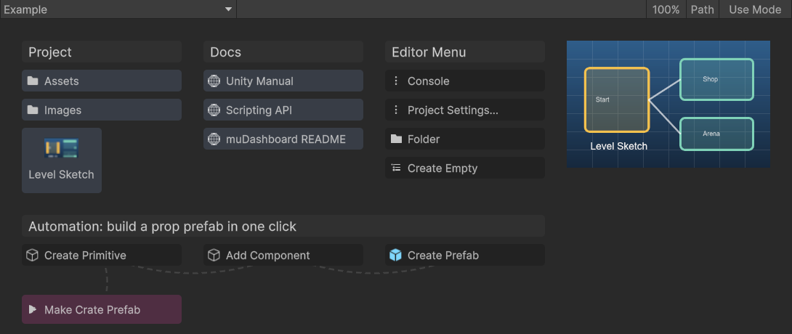
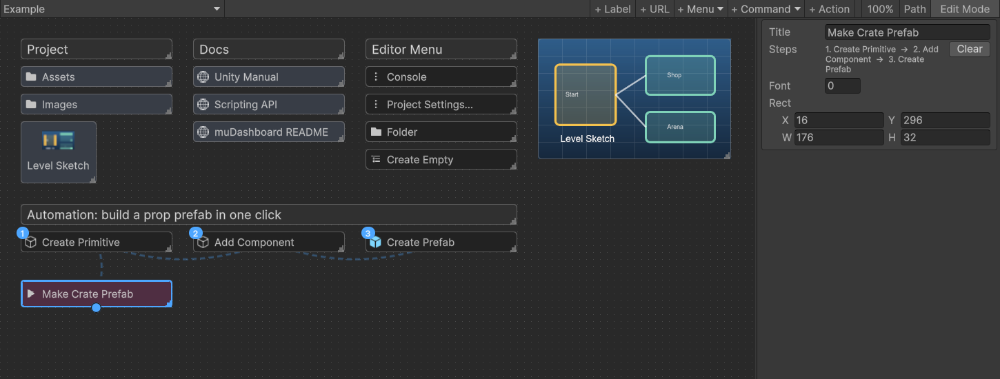
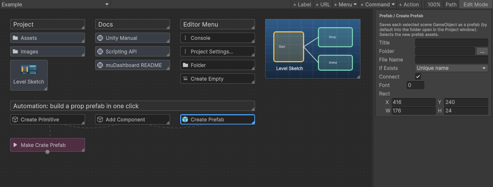

[English](README.md) | 日本語

# muDashboard

Project のアセット、シーンの GameObject、Web ページへのショートカットとラベルを、自由なレイアウトで並べられる Editor 拡張です。

作業ごとにパネルを `<任意名>.dashboard.json` として保存し、切り替えて使えます。`Tools/muDashboard/Dashboard` からウィンドウを開きます。

Unity 2022.3 以降。MIT License。



## インストール

Unity Package Manager から Git URL で追加します。

```
https://github.com/uisawara/mmzkworks-unitypackages.git?path=Assets/UnityPackages/works.mmzk.mudashboard
```

## サンプル

Package Manager でこのパッケージを選び、`Samples` の `Example Dashboard` を `Import` すると、`Assets/Samples/muDashboard/<バージョン>/Example Dashboard/` にサンプルパネルが入ります。`Example.dashboard.json` をダブルクリックすると Dashboard ウィンドウで開きます。上の画像がこのサンプルです。

- **Project**: `Assets` フォルダと、サンプル内の `Images` フォルダへのショートカット。高さを 56px 以上にした画像アセットのショートカットはタイル表示になります。
- **Docs**: Unity Manual・Scripting API・この README への URL ショートカット。
- **Editor Menu**: メニューコマンドのショートカット。`Console`・`Project Settings...` はエディタのメニュー、`Folder`(`Assets/Create/Folder`)は Project ウィンドウ、`Create Empty`(`GameObject/Create Empty`)は Hierarchy ウィンドウの選択に対して実行されます。
- **画像**: パネルに貼り付けた画像(`Level Sketch`)。資料やメモを並べておけます。
- **Automation**: `Create Primitive`(Cube、名前 `Crate`)→ `Add Component`(Rigidbody)→ `Create Prefab` を線でつないだ Action `Make Crate Prefab`。利用モードでクリックすると、シーンに Crate を作り、Rigidbody を付け、Project ウィンドウで開いているフォルダに Prefab として保存します。Undo 1 回でシーンの変更を戻せます(作られた Prefab アセットは残ります)。

## パネルファイル

- ツールバー左のドロップダウンに、Assets 以下にある `*.dashboard.json` が一覧表示されます。選ぶと作業ファイルが切り替わります。
- ドロップダウンの `New Panel...`、または Project ウィンドウの `Create/muDashboard/Dashboard` で新しいパネルを作成できます。
- Project ウィンドウで `*.dashboard.json` をダブルクリックすると、そのパネル用の Dashboard ウィンドウで開きます。別のパネルを開くとウィンドウが追加され(既存のウィンドウの隣にタブとして配置)、すでに開いているパネルはそのウィンドウにフォーカスします。
- ドロップダウンの `Open in New Window` で、今のウィンドウを切り替えずに別ウィンドウでパネルを開けます。
- 変更は自動で保存されます。

## 利用モードと編集モード

ツールバー右のトグルボタンで `Use Mode` / `Edit Mode` を切り替えます。

ツールバーの `Path` トグルで、各ショートカットの下にフルパス(アセットパス / URL / メニューパス)を表示するかを On/Off できます。

パネルはスクロールバーの無い、範囲の制限が無いキャンバスです。どちらのモードでも、マウスの中ボタンでドラッグすると任意の方向に移動でき、マウスホイールでカーソル位置を中心にズームイン・アウトできます(25%〜200%)。ツールバーに倍率が表示され、クリックすると 100% に戻ります。`F` キー(または何もない所の右クリック > `Frame All`)で、全要素の中央にスクロールします。

### 利用モード

- アセット / フォルダのショートカットをクリックすると、Project ウィンドウで選択されます。
- GameObject のショートカットをクリックすると、Hierarchy で選択されます。そのシーンが開いていない場合は、`Open Scene` / `Open Additive` で開くか確認します。
- URL のショートカットをクリックすると、標準ブラウザで開きます。
- メニューコマンドのショートカットをクリックすると、そのメニューを実行します(Project / Hierarchy のコマンドはそれぞれのウィンドウの現在の選択に対して実行されます)。
- Action をクリックすると、線でつないだ要素を順に実行します([Action](#action) を参照)。
- ショートカットをドラッグすると、Inspector のフィールドなどへそのままドラッグ & ドロップできます。
- 右クリックで `Copy Path` / `Copy URL` / `Copy Hierarchy Path` や `Open Asset` / `Open Scene` が使えます。

### 編集モード

- ショートカットやラベルをドラッグで移動、右下の角をドラッグで大きさを変更できます(8px グリッドにスナップ)。
- 何もない所からドラッグすると矩形選択で複数選択できます(`Shift` / `Ctrl`(`Cmd`)で追加選択、`Shift` / `Ctrl` クリックで個別に切り替え、`Ctrl+A` で全選択)。選択中の要素をドラッグするとまとめて移動し、`Delete`・複製・右クリックメニューも選択全体に適用されます。
- 選択中の要素は、右側のプロパティパネルでテキスト・URL・タイトル・フォントサイズ・位置とサイズを編集できます。パネルの左端をドラッグすると幅を変えられます。
- `+ Label` でラベルを、`+ URL` で URL ショートカットを追加します(クリップボードに URL があればそれを使います)。
- `+ Menu`(または右クリックの `Add Menu Command Here...`)で、メニューコマンドを検索して選べるピッカーが開きます。`Editor Menu` / `Project Window (Assets)` / `Hierarchy Window (GameObject)` に分かれています。
- `+ Command`(または右クリックの `Add Command Here...`)で自動化コマンドを追加します([コマンド](#コマンド) を参照)。
- `+ Action`(または右クリックの `Add Action Here`)で Action を追加します([Action](#action) を参照)。
- 右クリックで複製・前面へ・背面へ・削除。`Delete` キーでも削除できます。

## Action



編集モードで Action を選択すると、つないだ要素に実行順の番号が付き、右のプロパティパネルに手順が一覧されます。

パネル上の複数の要素を、順番にまとめて実行するボタンです。

- 編集モードで Action 下部の丸いノブからドラッグし、実行したい要素をなぞります。なぞった順に要素が線でつながります。もう一度なぞると線は置き換わります。同じ要素は 1 回だけ追加され、ラベルは対象外です。
- Action にマウスを乗せるか選択すると、各要素に実行順の番号が表示されます。右側のプロパティにも一覧が出て、`Clear` で消せます。
- 利用モードで Action をクリックすると、順に実行します。アセットは Project ウィンドウで、GameObject は Hierarchy で選択、URL は開き、メニューコマンドは実行します。「アセットを選択 → Project ウィンドウ向けのコマンドを実行」のようにつなげられます。
- 途中で失敗すると(アセットが見つからない、URL が不正、メニューコマンドが実行できない)、そこで止まります。失敗した要素が赤枠で示され、理由が通知されます。
- Action から別の Action をつなぐと、その中身がその位置で実行されます。自分自身を含む循環になっている場合はエラーとなり、何も実行しません。
- 要素を削除すると、すべての Action からも外れます。

## コマンド

「選択から Prefab を作る」「Prefab をシーンに置く」のような、引数付きの組み込み自動化コマンドです。`+ Command`(または右クリックの `Add Command Here...`)で追加し、プロパティパネルで引数を設定します。利用モードでクリックして単体で実行するか、[Action](#action) の線でつないで使います。



コマンド間の受け渡しは **Selection** で行います。各コマンドは現在の選択を対象にし、結果を選択した状態で終わるので、次のステップがそれを引き継ぎます。対象が無い・引数が不正な場合は失敗し、Action はそこで止まります。

| カテゴリ | コマンド |
|---|---|
| Prefab | Create Prefab、Create Prefab Variant、Instantiate Prefab、Unpack Prefab、Apply Overrides、Revert Overrides、Open Prefab Mode、Close Prefab Mode |
| GameObject | Create Empty、Create Primitive、Select GameObjects(パス / 名前 / タグ / Component で検索)、Select Relative(親 / 子 / ルート)、Rename(`{name}`、`{index}`)、Set Parent、Add Component、Remove Component、Reset Transform、Set Active、Duplicate、Delete |
| Scene | Open Scene、New Scene、Save Scene |
| Asset | Create Folder、Duplicate Asset、Move Asset、Save Assets |
| Dashboard | Open Dashboard(専用のウィンドウで開く / 実行したウィンドウの表示を切り替える) |

例:

- Prefab 化: `Select GameObjects`(パス `Env/Tree`)→ `Create Prefab`(Folder を空にすると Project ウィンドウで開いているフォルダに保存。`Assets/Prefabs` のように指定も可)
- Prefab を配置: Prefab アセットのショートカット(選択される)→ `Instantiate Prefab`(親 `Env`)→ `Rename`(`Tree_{index}`)

Action の実行によるシーンの変更は、Undo 1 回(`Action: <名前>`)でまとめて戻せます。アセットの作成・移動・複製は Undo できません。

## ショートカットの追加

- Project ウィンドウからフォルダやファイルをドラッグ & ドロップします。
- Hierarchy から GameObject をドラッグ & ドロップします(保存済みのシーンにあるものに限ります)。
- Web ブラウザからリンク / アドレスバーの URL をドラッグ & ドロップします。`.url` / `.webloc` のインターネットショートカットファイルも受け付けます。
- URL をコピーしてパネル上で `Ctrl+V`(macOS は `Cmd+V`)でも貼り付けられます。
- 編集モードでは、`Window/General/Console`・`Assets/Create/Folder`・`GameObject/Create Empty` のようなメニューパスをコピーして `Ctrl+V` すると、メニューコマンドのショートカットとして貼り付けられます。

アセットは GUID で記録するので、移動やリネームをしても追従します。GameObject は GlobalObjectId とシーンの GUID だけで記録するので、リネーム・親の変更・シーンの移動にも追従します。パスで探し直すことはしないため、ID で見つからなければ `(missing)` になります。シーンが開いていない間は、登録時の名前と「(scene not open)」でグレー表示になり、クリックするとシーンを開くか確認します。Action のステップにした GameObject は、シーンが開いていないと失敗します(Action の途中では確認ダイアログを出しません)。

ショートカットは高さを 56px 以上にすると、大きなアイコンのタイル表示になります。

## 画像

- Project ウィンドウの画像を `Alt` を押しながらドロップすると、画像として貼り付けます(普通にドロップするとアセットのショートカットになります)。
- エクスプローラー / Finder から画像ファイル(PNG・JPG・PSD など)をドロップすると、画像として貼り付けます。ファイルは先に `<パネルのフォルダ>/<パネル名> Images/` にコピーされます。
- 画像は縦横比を保って表示します。大きさは他の要素と同じく変えられ、プロパティパネルの `Fit to Image` で画像の縦横比に戻せます。画像の差し替えもプロパティパネルでできます。
- 画像は飾りです。クリックしても何も起きず、Action のステップにもできません。

## ファイル形式

```json
{
    "version": 1,
    "items": [
        { "id": "…", "kind": "asset", "guid": "…", "path": "Assets/Scenes", "x": 8, "y": 8, "width": 176, "height": 24, … },
        { "id": "…", "kind": "scene-object", "globalId": "GlobalObjectId_V1-2-…", "guid": "<scene guid>", "path": "Assets/Scenes/Main.unity", "hierarchy": "Env/Trees/Oak", … },
        { "id": "…", "kind": "url", "url": "https://docs.unity3d.com/", "title": "Unity Docs", … },
        { "id": "…", "kind": "menu", "menu": "GameObject/Create Empty", … },
        { "id": "…", "kind": "label", "title": "Scenes", "fontSize": 14, … },
        { "id": "…", "kind": "action", "title": "Setup", "steps": ["<item id>", "<item id>"], … },
        { "id": "…", "kind": "command", "command": "prefab.create", "args": [{ "key": "folder", "value": "Assets/Prefabs" }], … }
    ]
}
```
