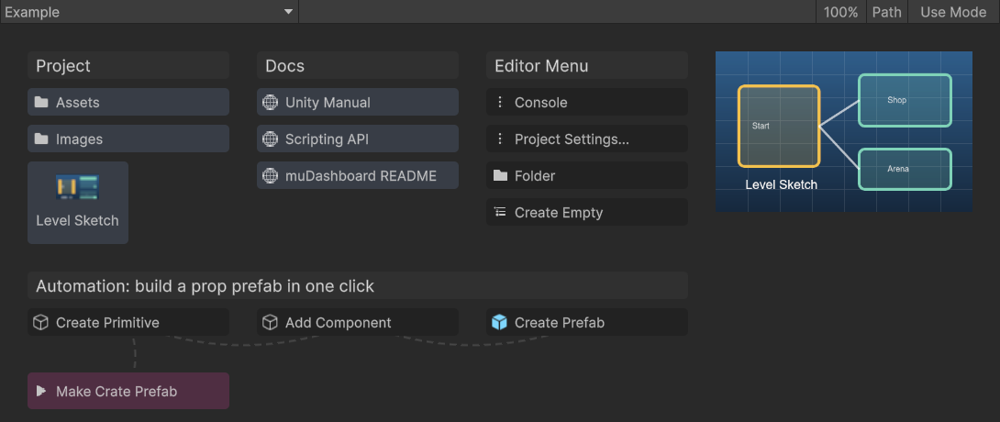
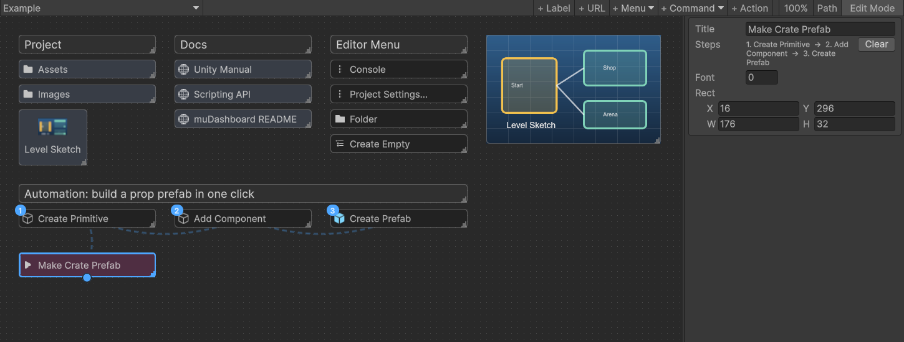
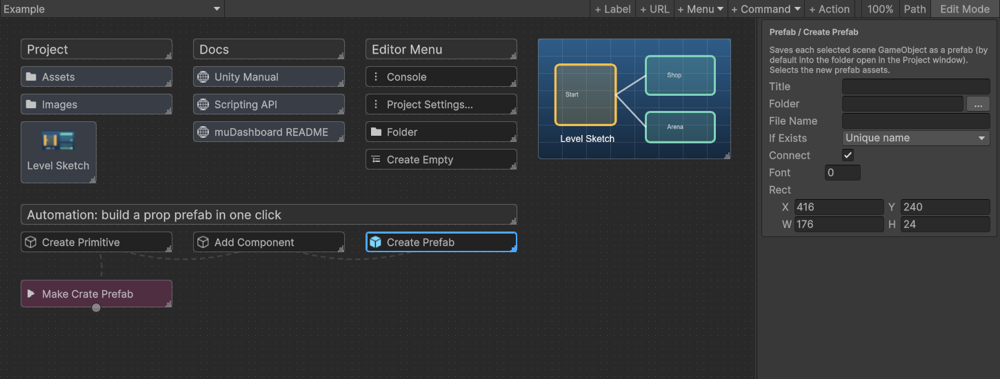

English | [日本語](README.ja.md)

# muDashboard

An Editor extension for laying out shortcuts to Project assets, scene GameObjects and web pages, plus labels, freely on a panel.

Save a panel per task as `<any name>.dashboard.json` and switch between them. Open the window from `Tools/muDashboard/Dashboard`.

Unity 2022.3 or later. MIT License.



## Installation

Add it from Unity Package Manager with a Git URL.

```
https://github.com/uisawara/mmzkworks-unitypackages.git?path=Assets/UnityPackages/works.mmzk.mudashboard
```

## Sample

Select this package in the Package Manager and `Import` `Example Dashboard` under `Samples`. A sample panel is added under `Assets/Samples/muDashboard/<version>/Example Dashboard/`; double-click `Example.dashboard.json` to open it in the Dashboard window. The image above is this sample.

- **Project**: shortcuts to the `Assets` folder and to the sample's `Images` folder. An image asset shortcut 56px or taller is drawn as a tile.
- **Docs**: URL shortcuts to the Unity Manual, the Scripting API and this README.
- **Editor Menu**: menu command shortcuts. `Console` and `Project Settings...` are editor menus, `Folder` (`Assets/Create/Folder`) acts on the Project window selection and `Create Empty` (`GameObject/Create Empty`) on the Hierarchy window selection.
- **Image**: a picture pasted onto the panel (`Level Sketch`), for keeping references and notes at hand.
- **Automation**: the action `Make Crate Prefab`, linking `Create Primitive` (Cube named `Crate`) → `Add Component` (Rigidbody) → `Create Prefab`. Click it in use mode to create a Crate in the scene, add a Rigidbody and save it as a prefab in the folder open in the Project window. One Undo reverts the scene changes (the prefab asset stays).

## Panel files

- The dropdown at the left of the toolbar lists every `*.dashboard.json` under Assets. Pick one to switch the working file.
- Create a new panel with `New Panel...` in the dropdown, or `Create/muDashboard/Dashboard` in the Project window.
- Double-click a `*.dashboard.json` in the Project window to open it in its own Dashboard window. Opening another panel adds another window (docked as a tab next to the existing ones); a panel that is already open just gets focused.
- `Open in New Window` in the dropdown opens a panel in a separate window instead of switching the current one.
- Changes are saved automatically.

## Use mode and edit mode

Switch between `Use Mode` and `Edit Mode` with the toggle button at the right of the toolbar.

The `Path` toggle in the toolbar shows or hides the full path (asset path / URL / menu path) under each shortcut.

The panel is an unbounded canvas with no scroll bars. In both modes, drag with the middle mouse button to move around in any direction, and use the mouse wheel to zoom in / out around the cursor (25% – 200%). The zoom level is shown in the toolbar; click it to go back to 100%. Press `F` (or right-click empty space > `Frame All`) to scroll to the center of all elements.

### Use mode

- Click an asset / folder shortcut to select it in the Project window.
- Click a GameObject shortcut to select it in the Hierarchy. If its scene is not open, you are asked whether to open it (`Open Scene` / `Open Additive`).
- Click a URL shortcut to open it in the default browser.
- Click a menu command shortcut to run that menu item (Project / Hierarchy commands act on the current selection in those windows).
- Click an action to run its linked elements in order (see [Actions](#actions)).
- Drag a shortcut to drop the asset elsewhere, e.g. onto an Inspector field.
- Right-click for `Copy Path` / `Copy URL` / `Copy Hierarchy Path` and `Open Asset` / `Open Scene`.

### Edit mode

- Drag shortcuts and labels to move them, drag the bottom-right corner to resize (snaps to an 8px grid).
- Drag on empty space to box select several elements (`Shift` / `Ctrl` (`Cmd`) adds to the selection, `Shift` / `Ctrl`-click toggles one, `Ctrl+A` selects all). Drag any selected element to move them together; `Delete`, `Duplicate` and the right-click menu apply to the whole selection.
- Edit the selected element's text, URL, title, font size and rect in the property panel on the right. Drag the panel's left edge to resize it.
- `+ Label` adds a label and `+ URL` adds a URL shortcut (uses the clipboard if it contains a URL).
- `+ Menu` (or `Add Menu Command Here...` in the right-click menu) opens a searchable picker of menu commands, grouped into `Editor Menu`, `Project Window (Assets)` and `Hierarchy Window (GameObject)`.
- `+ Command` (or `Add Command Here...` in the right-click menu) adds an automation command (see [Commands](#commands)).
- `+ Action` (or `Add Action Here` in the right-click menu) adds an action (see [Actions](#actions)).
- Right-click to duplicate, bring to front, send to back or delete. The `Delete` key also deletes.

## Actions



Select an action in edit mode to see the run order numbered on its linked elements and listed in the property panel on the right.

An action runs several elements of the panel one after another.

- In edit mode, drag from the round knob at the bottom of an action and trace over the elements to run. A line connects them in the traced order. Tracing again replaces the previous line; each element is added only once, and labels are ignored.
- Hover or select an action to show the step numbers. The steps are also listed in the property panel on the right, where `Clear` removes them.
- In use mode, click the action to run the steps in order: assets are selected in the Project window, GameObjects in the Hierarchy, URLs are opened, menu commands are executed. So "select an asset, then run a Project window command" works.
- If a step fails (missing asset, invalid URL, unavailable menu command), the run stops there, the step is outlined in red and a notification shows the reason.
- An action can include other actions; their steps run in place. A cycle (an action that ends up including itself) is reported as an error and nothing runs.
- Deleting an element removes it from every action.

## Commands

Commands are built-in automation steps with settings, e.g. "create a prefab from the selection" or "place a prefab in the scene". Add one with `+ Command` (or `Add Command Here...` in the right-click menu), set its arguments in the property panel, and click it in use mode, or link it into an [action](#actions).



Commands pass results through the **Selection**: each command works on what is selected and leaves its result selected, so the next step picks it up. If a command has nothing to work on or an argument is invalid, it fails and the action stops there.

| Category | Commands |
|---|---|
| Prefab | Create Prefab, Create Prefab Variant, Instantiate Prefab, Unpack Prefab, Apply Overrides, Revert Overrides, Open Prefab Mode, Close Prefab Mode |
| GameObject | Create Empty, Create Primitive, Select GameObjects (by path / name / tag / component), Select Relative (parent / children / root), Rename (`{name}`, `{index}`), Set Parent, Add Component, Remove Component, Reset Transform, Set Active, Duplicate, Delete |
| Scene | Open Scene, New Scene, Save Scene |
| Asset | Create Folder, Duplicate Asset, Move Asset, Save Assets |
| Dashboard | Open Dashboard (in its own window, or switch the window that ran it) |

Examples:

- Make a prefab: `Select GameObjects` (path `Env/Tree`) → `Create Prefab` (leave Folder empty to save into the folder open in the Project window, or set e.g. `Assets/Prefabs`)
- Place prefabs: a prefab asset shortcut (selects it) → `Instantiate Prefab` (parent `Env`) → `Rename` (`Tree_{index}`)

Running an action records its scene changes as one Undo step (`Action: <name>`). Creating, moving or duplicating assets cannot be undone.

## Adding shortcuts

- Drag and drop folders or files from the Project window.
- Drag and drop GameObjects from the Hierarchy (only from saved scenes).
- Drag and drop a link or the address bar URL from a web browser. `.url` / `.webloc` internet shortcut files are accepted too.
- Or copy a URL and press `Ctrl+V` (`Cmd+V` on macOS) on the panel.
- In edit mode, copying a menu path such as `Window/General/Console`, `Assets/Create/Folder` or `GameObject/Create Empty` and pressing `Ctrl+V` adds a menu command shortcut.

Assets (pictures included) are stored only by GUID, so shortcuts follow moves and renames. GameObjects are stored only by GlobalObjectId and the scene's GUID, so they follow renames, reparenting and scene moves. Neither falls back to a lookup by path: if the GUID / id cannot be found (also when a regenerated `.meta` gave the asset a new GUID), the shortcut shows `(missing)`. While the scene is closed, the shortcut is grayed out with the name it was registered with and "(scene not open)"; clicking it asks whether to open the scene. A GameObject used as an action step fails if its scene is not open (actions never stop to ask).

Make a shortcut 56px tall or more to show it as a tile with a large icon.

## Images

- Hold `Alt` while dropping image assets from the Project window to place them as pictures (a normal drop makes asset shortcuts).
- Drop image files (PNG, JPG, PSD, …) from Explorer / Finder to place them as pictures. They are copied into `<panel folder>/<panel name> Images/` first.
- Pictures keep their aspect ratio. Resize them like any element; `Fit to Image` in the property panel restores the image's proportions. You can also swap the image there.
- Pictures are decoration only: clicking does nothing and they cannot be steps of an action.

## File format

```json
{
    "version": 1,
    "items": [
        { "id": "…", "kind": "asset", "guid": "…", "path": "Assets/Scenes", "x": 8, "y": 8, "width": 176, "height": 24, … },
        { "id": "…", "kind": "scene-object", "globalId": "GlobalObjectId_V1-2-…", "guid": "<scene guid>", "path": "Assets/Scenes/Main.unity", "hierarchy": "Env/Trees/Oak", … },
        { "id": "…", "kind": "url", "url": "https://docs.unity3d.com/", "title": "Unity Docs", … },
        { "id": "…", "kind": "menu", "menu": "GameObject/Create Empty", … },
        { "id": "…", "kind": "label", "title": "Scenes", "fontSize": 14, … },
        { "id": "…", "kind": "action", "title": "Setup", "steps": ["<item id>", "<item id>"], … },
        { "id": "…", "kind": "command", "command": "prefab.create", "args": [{ "key": "folder", "value": "Assets/Prefabs" }], … }
    ]
}
```
