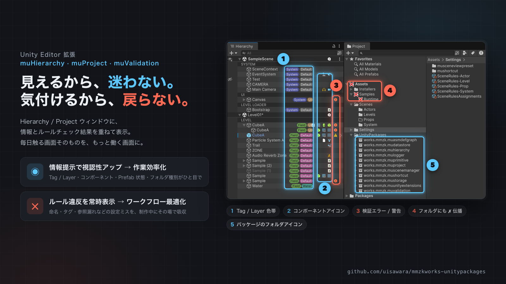
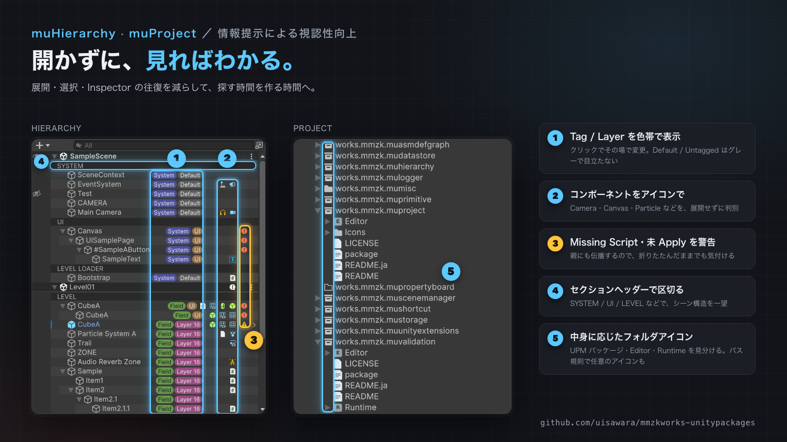
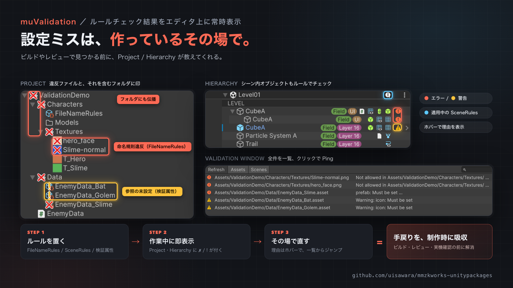
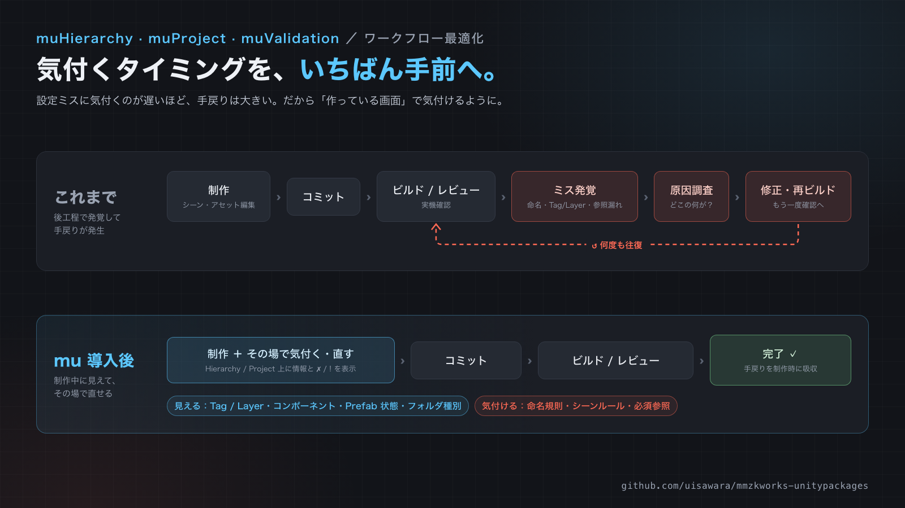
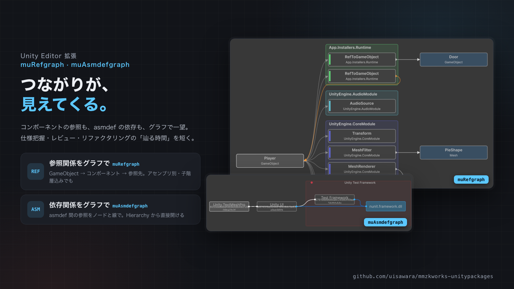
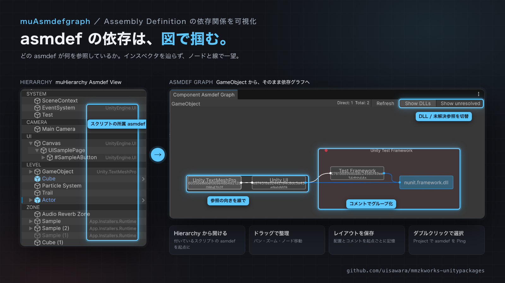
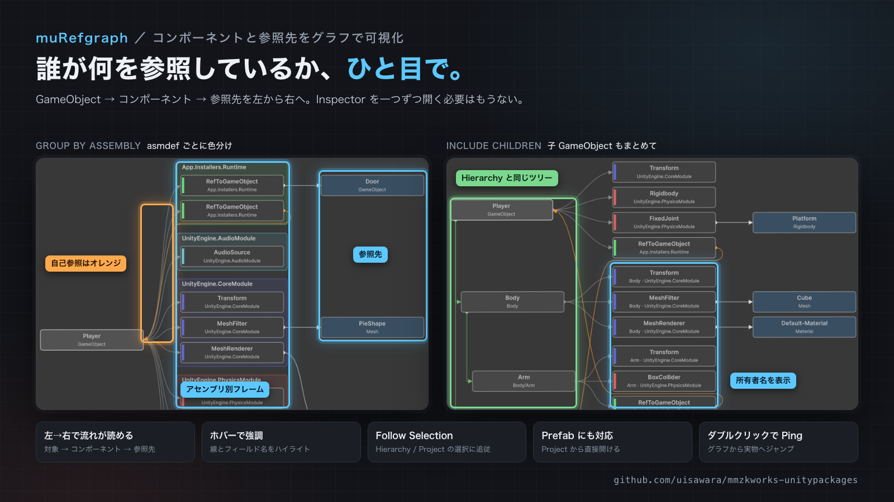
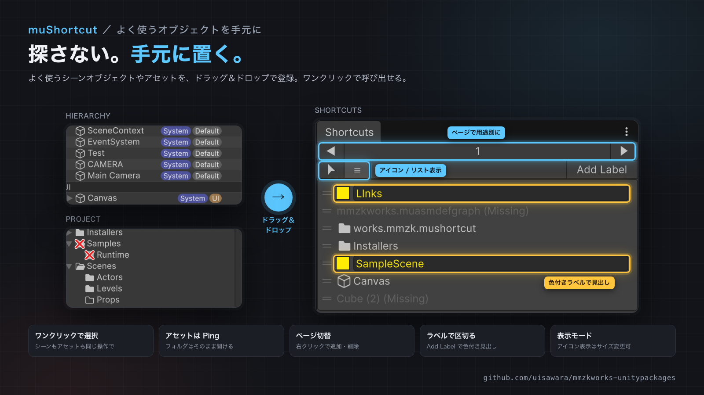

[English](README.md) | 日本語

> **NOTICE:**
> 以前から書き溜めてきたコード群を、昨今のAIが極短時間で実装できるようになってきた時流を思い、オープンにしたものです。AIを積極的に活用する方向へ舵を切っているため、生成コード比重が高くなっていく予定です。

## UPM Packages

### エディタ拡張



- [muHierarchy](Assets/UnityPackages/works.mmzk.muhierarchy/README.ja.md) — Prefab/コンポーネントのアイコン表示、Tag/Layer の色帯表示とその場での変更など、Hierarchy ウィンドウを拡張します。
- [muProject](Assets/UnityPackages/works.mmzk.muproject/README.ja.md) — フォルダの中身やパスのパターンに応じて、Project ウィンドウのフォルダアイコンを表示します。
- [muAsmdefgraph](Assets/UnityPackages/works.mmzk.muasmdefgraph/README.ja.md) — Assembly Definition の依存関係をグラフで可視化します。
- [muRefgraph](Assets/UnityPackages/works.mmzk.murefgraph/README.ja.md) — GameObject / Prefab の Component と、フィールドが参照しているオブジェクトをグラフで表示します。アセンブリ別の並べ替えもできます。
- [muShortcut](Assets/UnityPackages/works.mmzk.mushortcut/README.ja.md) — Hierarchy や Project ウィンドウのオブジェクトをショートカットで素早く選択できます。
- [muDashboard](Assets/UnityPackages/works.mmzk.mudashboard/README.ja.md) — Project のアセット・URL・メニューコマンドへのショートカットと、ラベル・画像・自動化コマンド・複数手順をまとめて実行する Action を自由に配置できるダッシュボードです。`*.dashboard.json` として保存し、作業ごとに切り替えられます。
- [muValidation](Assets/UnityPackages/works.mmzk.muvalidation/README.ja.md) — パスのルール・検証属性・シーンルールに基づいて、不正なアセットを Project ウィンドウ上でマークします。

#### 紹介画像















### シーン管理

- [muSceneManager](Assets/UnityPackages/works.mmzk.muscenemanager/README.ja.md) — UniTask を使ったメイン/サブシーンのキュー管理と、Inspector で扱いやすい SceneId を提供します。

### データ・ストレージ

- [muDatastore](Assets/UnityPackages/works.mmzk.mudatastore/README.ja.md) — PlayerPrefs やローカルファイルをバックエンドにした、シンプルな非同期キーバリューストアです。
- [muStorage](Assets/UnityPackages/works.mmzk.mustorage/README.ja.md) — ファイル・メモリ・キャッシュ・暗号化・ルーティング・ZIP パックを組み合わせられる非同期バイナリストレージです。

### ユーティリティ

- [muLogger](Assets/UnityPackages/works.mmzk.mulogger/README.ja.md) — ログレベルの色分けと差し替え可能な ILogger インターフェースを備えた名前付きロガーです。
- [muUnityExtensions](Assets/UnityPackages/works.mmzk.muunityextensions/README.ja.md) — GameObject・Vector・Texture2D など Unity の主要な型向けの拡張メソッド集です。
- [muPrimitive](Assets/UnityPackages/works.mmzk.muprimitive/README.ja.md) — 開発・デバッグや簡単な演出に使える補助プリミティブ形状(パイ、コーン、ラインシリンダー)です。

## リリース

リリースは [Conventional Commits](https://www.conventionalcommits.org/ja/)(`feat(scope): ...`、`fix(scope): ...`)をもとに [release-please](https://github.com/googleapis/release-please) で管理しています。

1. `develop` に PR をマージするたびに、[Release workflow](.github/workflows/release.yml) が release PR を作成・更新します。release PR には、前回のリリース以降にユーザー向けのコミット(`feat`、`fix`、`perf`、`revert`)があったパッケージの `package.json` の `version` の更新と `CHANGELOG.md` の追記が入ります(1.0.0 未満では `feat` でマイナー、`fix` でパッチが上がります)。対象のパッケージは、commit の scope ではなく変更したファイルのパスで決まります。`docs`、`test`、`refactor`、`ci`、`chore` などのコミットだけではリリースされません。
2. release PR をマージすると、更新されたパッケージごとに `<パッケージ名>/<version>` のタグと GitHub Release を作成し、`develop` → `main` の PR を開きます。

`CHANGELOG.md` とリリースノートはパッケージごとに分かれているので、workflow が各行の scope 表示を、そのパッケージ自身を含むときだけ消します(muDashboard の CHANGELOG なら `**mudashboard:**`)。ほかのパッケージだけを指す scope 表示は残します。内容が同じ行は 1 行にまとめ、PR と commit へのリンクを `,` 区切りで並べます。release PR の本文は、release-please が生成したままです。

`develop` への PR は squash でしかマージできず、PR タイトルだけがそのまま commit メッセージになります。PR タイトルは Conventional Commits の形式で書いてください。`develop` → `main` の PR は merge commit でしかマージできません。

PR タイトルは、その PR で変更したすべてのパッケージに適用されます。そのため、1 つの PR では 1 つのパッケージだけを変更し、複数のパッケージにまたがる変更は PR を分けてください。パッケージの `Tests` フォルダだけの変更は無視されます(隣にある `Tests.meta` は対象になるので、`Tests` フォルダを追加・削除する PR のタイトルは `test:` で始めてください)。そのパッケージに複数の項目(たとえば機能追加と修正)を記録したいときは、PR 本文に空行で区切って書くと、release-please は PR タイトルの代わりにこの内容を使います。

```
BEGIN_COMMIT_OVERRIDE
feat(mudashboard): ...

fix(mudashboard): ...
END_COMMIT_OVERRIDE
```

この目印の文字列は、使うとき以外は PR 本文に書かないでください。説明のつもりで書いただけでも、release-please は PR タイトルの代わりに本文の続きを使ってしまいます。

`develop` → `main` の PR をマージせずに閉じると、リリース済みの version が `main` に入るまで、`develop` に push するたびに作り直されます。

`package.json` の `version` は手で編集しないでください。パッケージを追加するときは、次の 2 つを行います。

- `release-please-config.json` に `"initial-version": "0.1.0"` と、`Tests` フォルダを指定した `"exclude-paths"` を付けて登録し、`.release-please-manifest.json` には `"0.0.0"` で登録する
- パッケージに空の `CHANGELOG.md`(と `.meta`)を追加する

`release-please-config.json` の `last-release-sha` は消さないでください。release-please が履歴を読み始める位置を示していて、消すと muAsmdefgraph と muRefgraph でリリース済みの commit を再び拾ってしまいます。

特定バージョンをインストールするには、Git URL の末尾にタグを指定します。

```
https://github.com/uisawara/mmzkworks-unitypackages.git?path=Assets/UnityPackages/works.mmzk.muhierarchy#works.mmzk.muhierarchy/0.3.1
```
