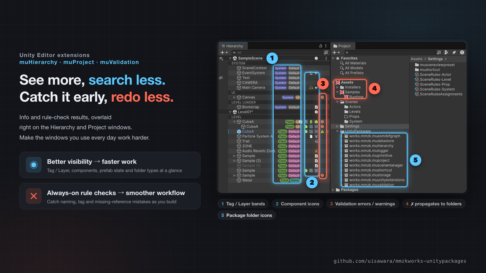
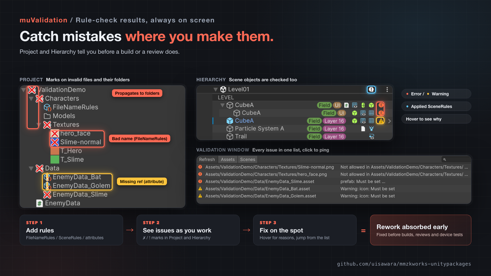
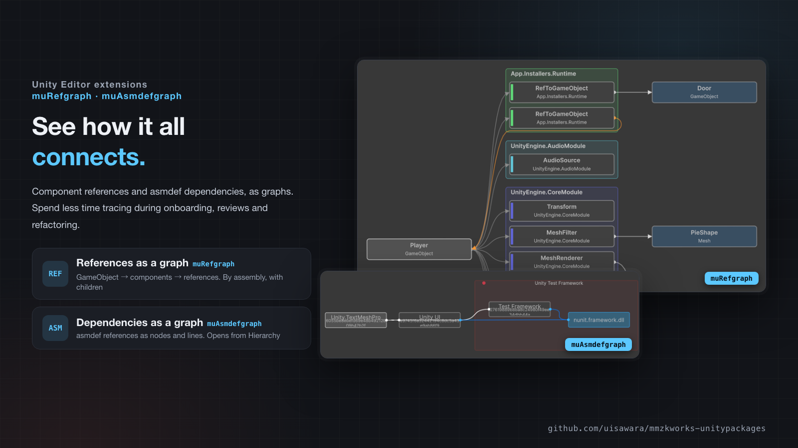
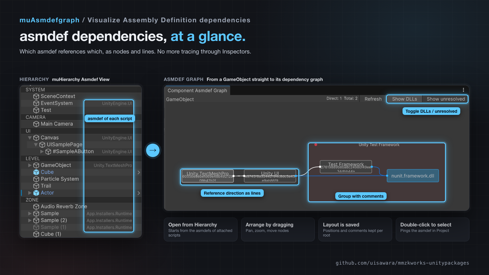

English | [日本語](README.ja.md)

> **NOTICE:**
> This is a collection of code I have been writing over time, made public in light of the recent trend where AI can implement such things in a very short time. As I am shifting toward actively using AI, the proportion of generated code is expected to grow.

## UPM Packages

### Editor Extensions



- [muHierarchy](Assets/UnityPackages/works.mmzk.muhierarchy/README.md) — Hierarchy window enhancements such as prefab/component icons and color-banded Tag/Layer labels you can change in place.
  - [](https://openupm.com/packages/works.mmzk.muhierarchy/)
- [muProject](Assets/UnityPackages/works.mmzk.muproject/README.md) — Project window folder icons based on folder contents or path patterns.
- [muAsmdefgraph](Assets/UnityPackages/works.mmzk.muasmdefgraph/README.md) — Visualizes Assembly Definition dependencies as a graph.
- [muRefgraph](Assets/UnityPackages/works.mmzk.murefgraph/README.md) — Shows a GameObject's or Prefab's components and the objects their fields reference as a graph, grouped by assembly if you like.
- [muShortcut](Assets/UnityPackages/works.mmzk.mushortcut/README.md) — Shortcut tool for quickly selecting objects in the Hierarchy and Project windows.
- [muDashboard](Assets/UnityPackages/works.mmzk.mudashboard/README.md) — Free-layout dashboard of shortcuts to Project assets, URLs and menu commands, plus labels, images, automation commands and actions that run several steps. Panels are saved as `*.dashboard.json` and can be switched per task.
- [muValidation](Assets/UnityPackages/works.mmzk.muvalidation/README.md) — Marks invalid assets in the Project window using path rules, validation attributes and scene rules.

#### Highlights










### Scene Management

- [muSceneManager](Assets/UnityPackages/works.mmzk.muscenemanager/README.md) — Queued main/sub scene management with UniTask and an Inspector-friendly SceneId.

### Data & Storage

- [muDatastore](Assets/UnityPackages/works.mmzk.mudatastore/README.md) — Simple async key-value data store with PlayerPrefs and local file backends.
- [muStorage](Assets/UnityPackages/works.mmzk.mustorage/README.md) — Composable async binary storage (file, memory, cache, encryption, routing, ZIP packs).

### Utilities

- [muLogger](Assets/UnityPackages/works.mmzk.mulogger/README.md) — Named logger with colored log levels and a swappable ILogger interface.
- [muUnityExtensions](Assets/UnityPackages/works.mmzk.muunityextensions/README.md) — Extension methods for common Unity types such as GameObject, Vector and Texture2D.
- [muPrimitive](Assets/UnityPackages/works.mmzk.muprimitive/README.md) — Helper primitive shapes (pie, cone, line cylinder) for development, debugging and simple effects.

## Releases

Releases are managed with [release-please](https://github.com/googleapis/release-please) based on [Conventional Commits](https://www.conventionalcommits.org/) (`feat(scope): ...`, `fix(scope): ...`).

1. Each time a pull request is merged into `develop`, the [Release workflow](.github/workflows/release.yml) opens or updates a release PR. It bumps `version` in `package.json` and updates `CHANGELOG.md` for every package with user-facing commits (`feat`, `fix`, `perf`, `revert`) since its last release (`feat` → minor, `fix` → patch while below 1.0.0). Packages are matched by the paths of the changed files, not by the commit scope. Commits such as `docs`, `test`, `refactor`, `ci` and `chore` alone do not trigger a release.
2. Merging the release PR creates a `<package-name>/<version>` tag and a GitHub Release for each bumped package, and opens a pull request from `develop` to `main`.

Since each package's `CHANGELOG.md` and release notes cover a single package, the workflow removes the scope (such as `**mudashboard:**`) from each entry. Entries with the same text are merged into one line that lists their PR and commit links, separated by commas. The release PR description still shows the entries as generated.

Pull requests into `develop` can only be squash-merged, and the PR title alone becomes the commit message, so write the title as a Conventional Commit. The pull request from `develop` to `main` can only be merged with a merge commit.

The PR title is applied to every package the PR touches, so keep each PR to one package; split changes to several packages into separate PRs. Changes only under a package's `Tests` folder are ignored (the `Tests.meta` file next to it is not, so start the title with `test:` when adding or removing a `Tests` folder). To record more than one entry for the package (for example a feature and a fix), list them in the PR description, separated by blank lines; they replace the PR title for release-please:

```
BEGIN_COMMIT_OVERRIDE
feat(mudashboard): ...

fix(mudashboard): ...
END_COMMIT_OVERRIDE
```

Write these markers in a PR description only when you mean to use them; even a mention in passing makes release-please replace the PR title with the rest of the description.

If the pull request from `develop` to `main` is closed without merging, it is opened again on the next push to `develop` while released versions are not yet on `main`.

Do not edit `version` in `package.json` by hand. When adding a package:

- Add it to `release-please-config.json` with `"initial-version": "0.1.0"` and `"exclude-paths"` for its `Tests` folder, and to `.release-please-manifest.json` as `"0.0.0"`.
- Add an empty `CHANGELOG.md` (with its `.meta`) to the package.

Keep `last-release-sha` in `release-please-config.json`. It marks where release-please starts reading history; without it, already released commits are picked up again for muAsmdefgraph and muRefgraph.

To install a specific version, append the tag to the Git URL:

```
https://github.com/uisawara/mmzkworks-unitypackages.git?path=Assets/UnityPackages/works.mmzk.muhierarchy#works.mmzk.muhierarchy/0.3.1
```
