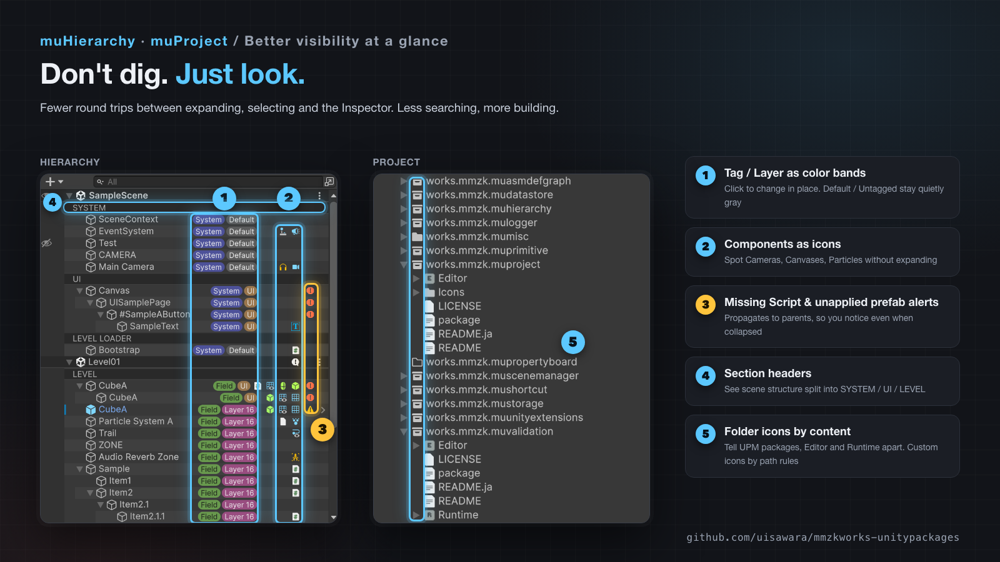
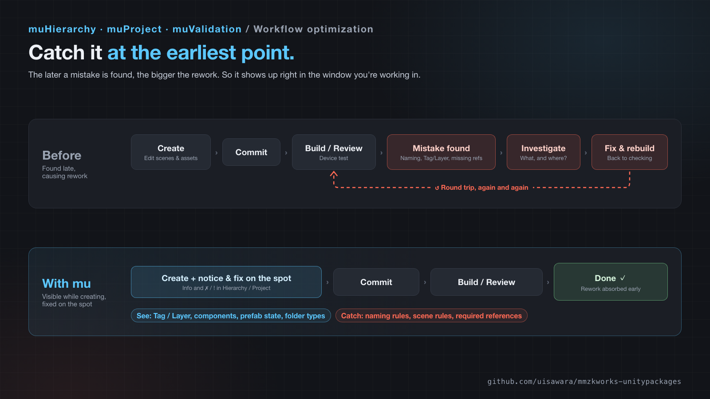
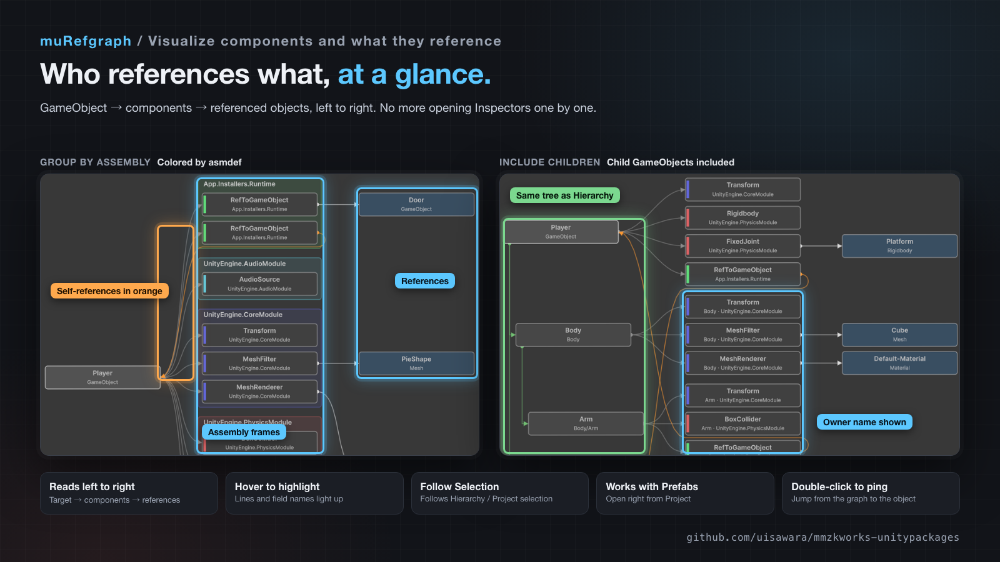
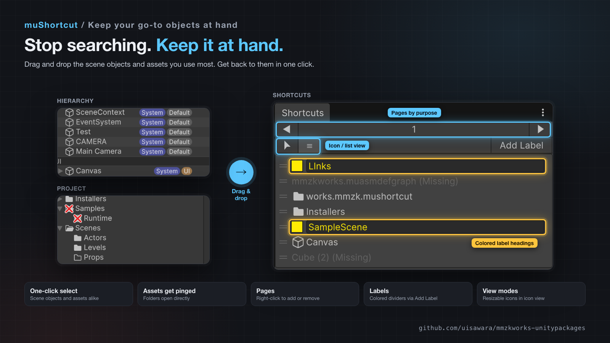

English | [日本語](README.ja.md)

> **NOTICE:**
> This is a collection of code I have been writing over time, made public in light of the recent trend where AI can implement such things in a very short time. As I am shifting toward actively using AI, the proportion of generated code is expected to grow.

## UPM Packages

### Editor Extensions


- [muHierarchy](Assets/UnityPackages/works.mmzk.muhierarchy/README.md) — Hierarchy window enhancements such as prefab/component icons and color-banded Tag/Layer labels you can change in place.
  - [](https://openupm.com/packages/works.mmzk.muhierarchy/)
- [muProject](Assets/UnityPackages/works.mmzk.muproject/README.md) — Project window folder icons based on folder contents or path patterns.
- [muAsmdefgraph](Assets/UnityPackages/works.mmzk.muasmdefgraph/README.md) — Visualizes Assembly Definition dependencies as a graph.
- [muRefgraph](Assets/UnityPackages/works.mmzk.murefgraph/README.md) — Shows a GameObject's or Prefab's components and the objects their fields reference as a graph, grouped by assembly if you like.
- [muShortcut](Assets/UnityPackages/works.mmzk.mushortcut/README.md) — Shortcut tool for quickly selecting objects in the Hierarchy and Project windows.
- [muDashboard](Assets/UnityPackages/works.mmzk.mudashboard/README.md) — Free-layout dashboard of shortcuts to Project assets, URLs and menu commands, plus labels, images, automation commands and actions that run several steps. Panels are saved as `*.dashboard.json` and can be switched per task.
- [muValidation](Assets/UnityPackages/works.mmzk.muvalidation/README.md) — Marks invalid assets in the Project window using path rules, validation attributes and scene rules.

#### Highlights











### Scene Management

- [muSceneManager](Assets/UnityPackages/works.mmzk.muscenemanager/README.md) — Queued main/sub scene management with UniTask and an Inspector-friendly SceneId.

### Data & Storage

- [muDatastore](Assets/UnityPackages/works.mmzk.mudatastore/README.md) — Simple async key-value data store with PlayerPrefs and local file backends.
- [muStorage](Assets/UnityPackages/works.mmzk.mustorage/README.md) — Composable async binary storage (file, memory, cache, encryption, routing, ZIP packs).

### Utilities

- [muLogger](Assets/UnityPackages/works.mmzk.mulogger/README.md) — Named logger with colored log levels and a swappable ILogger interface.
- [muUnityExtensions](Assets/UnityPackages/works.mmzk.muunityextensions/README.md) — Extension methods for common Unity types such as GameObject, Vector and Texture2D.
- [muPrimitive](Assets/UnityPackages/works.mmzk.muprimitive/README.md) — Helper primitive shapes (pie, cone, line cylinder) for development, debugging and simple effects.

## Releases

Releases are managed with [release-please](https://github.com/googleapis/release-please) based on [Conventional Commits](https://www.conventionalcommits.org/) (`feat(scope): ...`, `fix(scope): ...`).

1. Each time a pull request is merged into `develop`, the [Release workflow](.github/workflows/release.yml) opens or updates a release PR. It bumps `version` in `package.json` and updates `CHANGELOG.md` for every package that changed since its last release (`feat` → minor, `fix` → patch while below 1.0.0).
2. Merging the release PR creates a `<package-name>/<version>` tag and a GitHub Release for each bumped package, and opens a pull request from `develop` to `main`.

Do not edit `version` in `package.json` by hand. When adding a package, add it to `release-please-config.json` and `.release-please-manifest.json`, and add a `CHANGELOG.md` (with its `.meta`) to the package.

To install a specific version, append the tag to the Git URL:

```
https://github.com/uisawara/mmzkworks-unitypackages.git?path=Assets/UnityPackages/works.mmzk.muhierarchy#works.mmzk.muhierarchy/0.3.1
```
